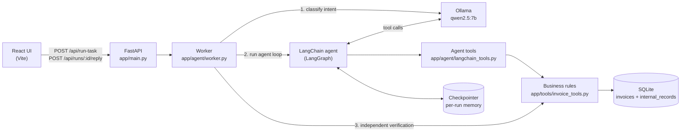

# CentrAlign AI — Autonomous Task Worker

A prototype AI worker that takes a natural-language task, decides which actions to take, performs them against a simulated company system, verifies the outcome, and asks the user when it cannot safely continue.

> **Example:** *"Find the latest invoice from Acme Corp, read its amount and due date, save it in the internal system, and verify that it was saved correctly."*
>
> The agent searches the source invoices, picks the newest one, reads it, saves it to the internal system, verifies the saved record, and returns a summary with step-by-step evidence.

**Demo video:** _add link here_

---

## Contents

- [What it can do](#what-it-can-do)
- [Quick start](#quick-start)
- [Architecture](#architecture)
- [How a task runs](#how-a-task-runs)
- [Key design decisions](#key-design-decisions)
- [Reliability and failure handling](#reliability-and-failure-handling)
- [Testing](#testing)
- [Generalization](#generalization)
- [Known limitations](#known-limitations)
- [What I would build next](#what-i-would-build-next)
- [Assumptions](#assumptions)
- [Tech stack](#tech-stack)

---

## What it can do

| Capability from the brief | How this prototype does it |
|---|---|
| Understand the goal, not every step | The user describes an outcome; the LLM chooses which tools to call and in what order. |
| Break the request into actions | A tool-calling agent loop (reason → act → observe → repeat). |
| Use tools | Search, read, save and verify tools over a simulated invoice system (SQLite). |
| Observe and decide next step | Every tool result is fed back to the model before its next decision. |
| Remember information during execution | Run state is kept per run (LangGraph checkpointer), so IDs, amounts and dates found earlier are used later — including after the user replies to a question. |
| Detect failures | Tools return structured errors; the agent loop catches step-limit, timeout and connection failures. |
| Retry / alternative | The model sees tool errors and can correct its call (e.g. re-read the invoice after a rejected save). |
| Verify the outcome | Two layers: the agent's own verify step **and** an independent database check by code after the run. |
| Ask for clarification | An `ask_user_tool` pauses the run; the user replies in the UI and the same run continues. |
| Summary and evidence | Status, reason, answer, a step-by-step timeline of tool calls, and a source-vs-saved comparison. |

Demo tasks (available as one-click examples in the UI):

| Task | Expected result |
|---|---|
| Save the latest Acme Corp invoice | ✅ `completed` — saved and verified |
| "What is the amount and due date of the latest Northwind Ltd invoice?" | ✅ `completed` — answered, **nothing saved** |
| "Save the latest invoice from Acme" | ❓ `needs_clarification` — Acme Corp or Acme Logistics? |
| "Record the latest invoice from Wayne Enterprises" | ❓ `needs_clarification` — supplier not found |
| Any task with Ollama stopped | ❌ `failed` — clean error, no crash |

---

## Quick start

### Prerequisites

- **Python** 3.10+ (developed on 3.13)
- **Node.js** 20.19+ (developed on 24)
- **[Ollama](https://ollama.com/download)** running locally, with the model pulled:

```bash
ollama pull qwen2.5:7b
```

### 1. Backend

From the project root:

```bash
python -m venv .venv

# Windows
.venv\Scripts\activate
# macOS / Linux
source .venv/bin/activate

pip install -r requirements.txt
```

Create the config file by copying the example (the defaults work as-is):

```bash
# Windows
copy app\.env.example app\.env
# macOS / Linux
cp app/.env.example app/.env
```

Start the API (from the project root):

```bash
uvicorn app.main:app --reload
```

The API runs at `http://127.0.0.1:8000` (interactive docs at `/docs`). On startup it creates `worker.db` and seeds 13 demo invoices.

### 2. Frontend

In a second terminal:

```bash
cd frontend
npm install
npm run dev
```

Open **http://localhost:5173**. Vite proxies `/api` requests to the backend.

### 3. Tests

```bash
python -m pytest
```

### Reset demo data

Stop the backend and delete `worker.db`. It is recreated and re-seeded on the next start.

### Configuration (`app/.env`)

| Variable | Default | Purpose |
|---|---|---|
| `OLLAMA_HOST` | `http://localhost:11434` | Ollama server URL |
| `OLLAMA_MODEL` | `qwen2.5:7b` | Model used for all decisions |
| `OLLAMA_TIMEOUT_SECONDS` | `120` | Per-request timeout to the model |
| `MAX_AGENT_STEPS` | `8` | Maximum agent decisions per run |
| `DATABASE_PATH` | `worker.db` | SQLite file (relative to where the server is started) |

### API

| Method | Endpoint | Purpose |
|---|---|---|
| `POST` | `/api/run-task` | Start a run: `{"task": "..."}` |
| `POST` | `/api/runs/{run_id}/reply` | Answer the agent's question: `{"reply": "..."}` |
| `GET` | `/api/invoices` | Source invoices (the "company data") |
| `GET` | `/api/records` | Records saved in the internal system |
| `GET` | `/api/health` | Health check |

---

## Architecture



### Project structure

```
app/
  main.py                  FastAPI endpoints
  config.py                Settings from app/.env
  agent/
    worker.py              Run lifecycle: intent, agent loop, error handling,
                           independent verification, final status
    langchain_tools.py     Tools exposed to the LLM (thin wrappers, return JSON)
  tools/
    invoice_tools.py       Business logic and safety rules (no LLM code)
  database/
    db.py                  SQLite schema and seed data
frontend/src/
  App.jsx                  Task form, result, timeline, evidence, data tables
  api.js                   API client
tests/
  conftest.py              Gives every test its own temporary database
  test_tools.py            39 tests for tools and safety rules
```

The layers are deliberately separated: **`invoice_tools.py` knows nothing about LLMs**, `langchain_tools.py` only adapts it for the model, and `worker.py` owns the run lifecycle. A different domain means new tools, not a new agent.

---

## How a task runs

1. **Intent check.** A short structured-output call asks the model whether the task requires saving anything (`requires_save`).
2. **Pick the toolset.** Save tasks get all tools. Read-only tasks get an agent **without** the save and verify tools.
3. **Agent loop.** The model reasons, calls a tool, reads the result, and decides the next step, until it answers or asks a question. The step budget is `MAX_AGENT_STEPS`.
4. **Business rules in tools.** `save_invoice_tool` re-reads the source invoice and rejects the save if the amount or due date differ. The supplier is copied from the source, never from the model.
5. **Independent verification.** After the loop ends, code re-queries the database for every invoice the agent tried to save and compares it to the source.
6. **Status decided by code, not by the model's text:**

| Status | When |
|---|---|
| `completed` | Save task: a record passed **both** the agent's verify step and the independent check. Read-only task: answered from successful tool results. |
| `needs_clarification` | The run ended on `ask_user_tool`. The question is returned and the run waits for `/reply`. |
| `failed` | Required save not verified, step limit hit, model unreachable or timed out, or any other agent error. Includes the reason and the partial trace. |

7. **Response.** `status`, `reason`, `answer`, `tool_trace`, `verification` evidence and `verified_invoice_ids`. The UI renders these as a timeline and a source-vs-saved comparison.

---

## Key design decisions

**1. The LLM decides, the code enforces.**
The model chooses which actions to take, but every action goes through tools that enforce the business rules. Even if the model makes up an amount, `record_invoice` compares it against the source invoice and refuses the write. The model can choose actions, but it cannot write bad data.

**2. Success is verified by code, not claimed by the model.**
A model saying "done" is not evidence. A save only counts if the agent's verify step passed **and** a fresh database query after the run agrees. The final status comes from this check, not from the answer text.

**3. Least privilege per task.**
During testing, the agent saved an invoice when it was only asked a question. A prompt rule is not a guarantee, so read-only tasks now run with an agent that **does not have** the write tools. The model cannot misuse a tool it was never given.

**4. Clarification is a tool, not free text.**
`ask_user_tool` uses `return_direct`, so the loop stops immediately and the question becomes a structured `needs_clarification` result. The run's message history is kept by a LangGraph checkpointer keyed by `run_id`, so the user's reply continues the same run with full context, not a new one.

**5. Writes are idempotent.**
Saving an invoice that already exists returns `already_exists` with the original record instead of creating a duplicate (backed by a `UNIQUE` constraint). Retries are always safe.

**6. Failures return a result, not a crash.**
Step-limit, timeout and connection errors are caught and returned as `failed` with a clear reason. Because every step is checkpointed, the partial trace is still shown.

**7. A narrow environment that genuinely works.**
I chose a small simulated company system (SQLite, real reads and writes) over a broad system where most functionality is mocked. Nothing in the pipeline is faked: every step in the trace is a real tool call with a real result.

**8. Local model.**
Ollama with `qwen2.5:7b` at temperature 0: no API keys, no data leaves the machine, and the results are reproducible. Because a 7B model is a weak reasoner, the code-level safety rules matter even more.

**9. When the prompt isn't enough, move the rule into the tool.**
A prompt rule ("if several suppliers match, ask") was ignored by the 7B model: for "Acme" it just picked an invoice. Now the search tool itself refuses ambiguous supplier names and returns the candidates (Acme Corp, Acme Logistics) as an error, so asking the user is the only sensible next step. The same principle runs through the design: important behaviour is enforced in code, and the prompt only guides.

---

## Reliability and failure handling

| Situation | What happens |
|---|---|
| Model passes a wrong amount or due date | Save rejected with an error; nothing written; the model sees the error and can re-read and retry |
| Bad date format | Rejected: `Due date must use YYYY-MM-DD format.` |
| Unknown invoice ID | Read and save return an error; nothing written |
| Same invoice saved twice | `already_exists`, no duplicate |
| Saved record tampered with afterwards | Verification reports a mismatch → `failed` |
| Supplier not found | Agent calls `ask_user_tool` → `needs_clarification` |
| Supplier name matches several suppliers ("Acme") | Search returns an error listing the candidates instead of a mixed list → agent asks which one |
| Agent loops without finishing | Stopped at `MAX_AGENT_STEPS` → `failed` with partial trace |
| Ollama not running | `failed`: "Could not reach the language model … Is Ollama running?" |
| Model too slow | `failed` after `OLLAMA_TIMEOUT_SECONDS` |
| Reply to a finished or unknown run | HTTP 409 / 404 |

---

## Testing

`python -m pytest` runs **39 tests**. Each test runs against its own temporary database (`tests/conftest.py`), so tests never touch the demo data and do not depend on each other.

They cover:
- **Search:** newest-first ordering, case-insensitive matching, ambiguous supplier names returning candidates, exact names winning over partial matches, unknown or blank suppliers, limit clamping.
- **Read:** full details, whitespace in IDs, missing invoice.
- **Save safeguards:** wrong amount, wrong due date, five bad date formats, unknown invoice (each also checks that nothing was written), float tolerance, supplier copied from the source, idempotency, same-day invoices.
- **Verification:** missing source, never saved, tampered record, and save + verify for every seed invoice.
- **Agent tool wrappers:** every tool has a description for the model, results are valid JSON, safeguards still apply through the wrapper, and `ask_user_tool` stops the loop.

The agent loop itself was tested manually against the local model (scenarios in [What it can do](#what-it-can-do)). Automated agent-level tests are listed under next steps.

---

## Generalization

| Stays the same for a new task type | Changes |
|---|---|
| Agent loop, run and reply lifecycle | Tools for the new domain |
| Clarification and memory per run | System prompt guidance |
| Failure handling and step budget | Verification rule for the new kind of write |
| Trace, evidence and status reporting | |
| Frontend (timeline, status, reply) | |

The agent does not follow a hard-coded sequence: the same code answers questions, saves invoices, and asks for clarification, depending only on the request.

---

## Known limitations

- **Simulated environment.** The "company system" is SQLite accessed through Python functions. There is no browser automation, file or PDF reading, or external API yet.
- **One domain.** The tools, the system prompt (which still lists invoice steps) and the verification rule are invoice-specific.
- **Runs live in memory.** Pending clarifications are lost on server restart; it runs as a single process with no persistent run history.
- **The intent check uses the LLM.** It can misclassify a task. If classification fails it falls back to "requires save", which is the safer default.
- **No approval step before writing.** The agent can ask questions, but there is no "approve this save?" gate yet.
- **Recovery depends on the model.** Tool errors are clear and the model can retry, but there is no programmatic retry or backoff for the LLM calls themselves.
- **Small local model.** `qwen2.5:7b` is slow on CPU and can occasionally skip a step or phrase its answer optimistically. The status field is always the source of truth, not the answer text.
- **Supplier matching is a substring search.** Same-day invoices from one supplier depend on the model noticing the tie.
- **The request blocks until the run finishes.** There is no live streaming of steps to the UI.
- **No authentication.** CORS is configured for local development only.
- **No automated agent-level tests or evaluation suite yet.**

---

## What I would build next

1. **Human approval before writes.** Pause before `save_invoice_tool` with "Save INV-…, ₹…, due …?" and continue only on approval (LangChain `HumanInTheLoopMiddleware` + a persistent checkpointer).
2. **Persistent runs.** A SQLite checkpointer and a `task_runs` table, giving durable clarifications, run history, an audit log and memory across tasks.
3. **Agent evaluation suite.** A fixed set of tasks (happy path, ambiguous, unknown, read-only, already saved, adversarial) with pass rates per model and prompt version.
4. **Real "computer use".** Invoices arriving as PDFs or emails (extraction plus a confidence check), and a small internal web app that the agent fills in through a browser (Playwright), verified by reading the page back.
5. **Live step streaming** to the UI (Server-Sent Events) instead of one blocking request.
6. **More task types without touching the agent loop** (mark as paid, list overdue invoices, reconcile), using a tool registry and per-tool verification rules.
7. **Programmatic retries** with backoff for model and tool calls, plus per-tool timeouts.
8. **Model comparison.** Run the eval suite on larger local and hosted models to measure the reliability vs cost trade-off.

---

## Assumptions

- The "internal system" is simulated by an `internal_records` table; the "source" is an `invoices` table. Both are seeded with fictional data.
- "Latest invoice" means the greatest `invoice_date`.
- The source invoice is the trusted reference. A saved record is correct if supplier, amount and due date match it exactly (amount within 0.001).
- Dates use the `YYYY-MM-DD` format.
- One user and local use only; no authentication or multi-tenant concerns.
- No real company data, credentials or third-party systems are used.

---

## Tech stack

| Component | Used for |
|---|---|
| [Ollama](https://ollama.com) + **Qwen2.5 7B** | Local LLM for intent classification and agent decisions |
| **LangChain v1** (`create_agent`) | Tool-calling agent loop |
| **LangGraph** (`InMemorySaver`) | Per-run state, enabling clarification and reply |
| `langchain-ollama` | Ollama chat model integration |
| **FastAPI** + Uvicorn | REST API |
| Pydantic | Request validation and structured intent output |
| **SQLite** | Simulated source system and internal system |
| **React 19** + **Vite** | Frontend |
| Axios | HTTP client |
| pytest | Tests |


